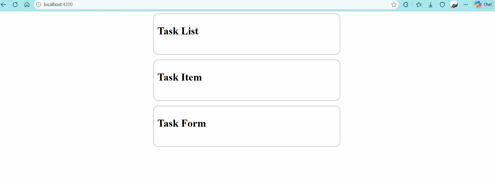
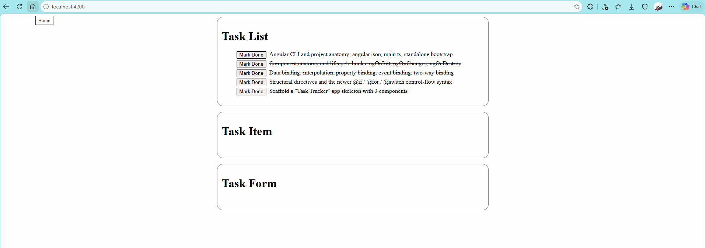
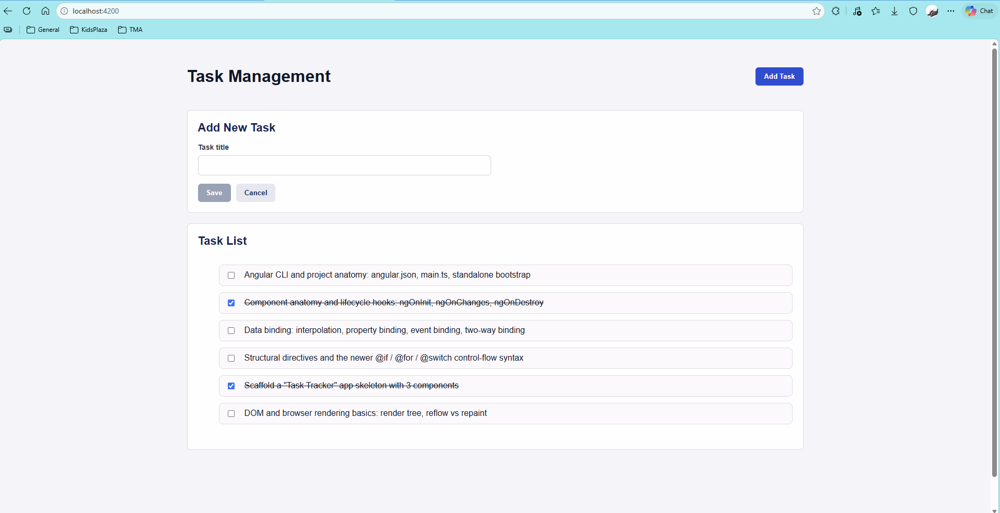
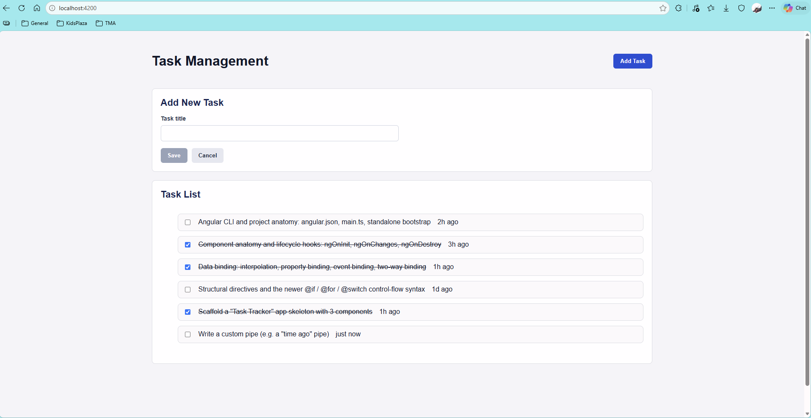

# TaskTracker
## Week 0
### Hands-on 1
Run `ng new task-tracker` (standalone, no routing yet). Generate three components: TaskList, TaskItem, and TaskForm, each just rendering a placeholder heading for now.

Done when: `ng serve` shows all three component placeholders rendered on one page.
Result:

### Hands-on 2
In TaskListComponent, hardcode an array of 5 sample tasks ({id, title, done}) directly in the class. Render them with @for, show the title via interpolation, apply a strikethrough style with [class.done], and add a button with (click) that toggles a task's done flag.

Done when: Clicking the button visually strikes through and un-strikes the task title, driven entirely by binding — no page reload.

Result:

## Week 1
### Hands-on 1
Move the task array up to the parent (e.g. AppComponent) as the single source of truth. TaskItem receives one task via @Input and emits a 'toggle' event via @Output; TaskForm emits a 'create' event with the new title. Wire it so the parent is the only place that mutates the array.

Done when: You can add a task via the form and toggle any task's done state, with data flowing down via @Input and events flowing up via @Output — no child component touches the array directly.

Result:

### Hands-on 2
Add a `createdAt` timestamp to each task. Write a `timeAgo` pipe that turns it into strings like '2m ago' or '3h ago', and apply it in the TaskItem template.

Done when: A freshly created task shows 'just now', and an older hardcoded task shows a sensible relative time.
Result:

